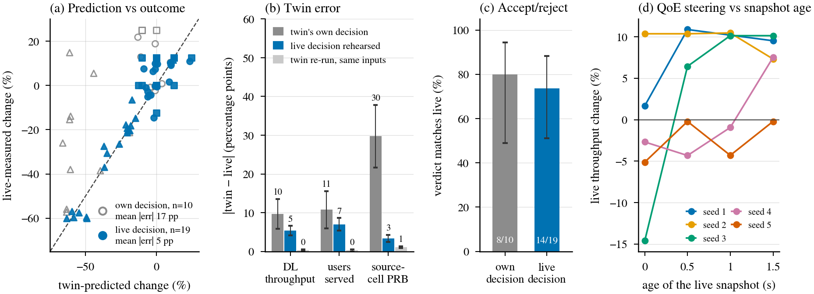

# Response to the reviewers — WCM-26-00422 (major revision)

**AppWeaver: Agentic Discovery and Composition of O-RAN Apps for AI-Native 6G**

Dear Guest Editor, dear Reviewers,

We thank you for the careful and constructive reviews. They led us to rebuild the evaluation rather than
polish it. While answering them we also found a flaw in our own evaluation harness (a repair step could
read the labelled workflow of templated intents), so the numbers of the first submission are withdrawn and
every result in the revision is new. The revision keeps the magazine limits (6 figures and tables, 15
references, about 3,500 words). Section IV is rewritten; Fig. 2 is now a trace recorded from a run, Fig. 4
shows system KPIs while composed workflows act, and Fig. 5 reports composition accuracy and the measured
and twin-predicted KPI impact. The code, the three intent benchmarks, the Agent Cards and every run record
are public at https://github.com/Dangy1/flexric-py310 (branch `appweaver-revision`); full per-method tables
with confidence intervals are in `evaluation/paper_results/README.md` there.

Below, each comment is quoted in short and answered; section, figure and table numbers refer to the
revised manuscript.

---

## Guest Editor

> Insufficient differentiation from existing agentic O-RAN frameworks, limited network-level evaluation and
> digital-twin validation, inadequate details about the benchmark, baselines, and reliability metrics;
> clarification of the actual xApp/rApp implementations, stronger statistical evidence, and evaluation of
> scalability.

| Concern | Where it is addressed |
|---|---|
| Differentiation from agentic O-RAN frameworks | R1.1, R3.7: §II, §III-B, Table I |
| Network-level evaluation, digital-twin validation | R1.2, R2.2, R3.1: §IV-D, Figs. 4 and 5(c) (new) |
| Benchmark, baselines, reliability metrics | R1.4–R1.6, R2.1, R2.3, R3.2–R3.5: §IV-B, §IV-E |
| Actual xApp/rApp implementations | R1.3, R4.6: §IV-A |
| Statistical evidence | R2.1, R3.3, R3.6, R4.3: 8,712 records, 3–5 repeats, 95% CIs (Fig. 5) |
| Scalability | R4.1: registry of 81 Agent Cards, retrieval ablation (§IV-B/C) |

---

## Reviewer 1

**R1.1** — *Distinction from AgentRAN, which also uses A2A and MCP; what AppWeaver adds; O-RAN-specific
information in the Agent Cards; how dependency, interface and control-scope compatibility are checked.*

AppWeaver shares A2A and MCP as transport with AgentRAN, but its agents do not control the RAN: they select
and chain existing xApps and rApps. What AppWeaver adds is (i) Agent Cards with O-RAN-specific content:
application type and RIC, E2 service models and A1/O1 interfaces, data models consumed and produced,
control scope (cell, UE, slice, node, transport; read or write), timescale, `requires`, `conflicts_with` and
lifecycle state; (ii) five explicit checks of every composed chain against these declarations before
deployment: dependency (each step's inputs are produced upstream), interface, control scope (no two writers
on one control resource without serialization), timescale (no near-RT control right after a non-RT step
without fresh observation) and lifecycle (deprecated releases rejected); errors return the plan to the
Planner for repair, and every verdict is stored per record; (iii) a dry-run on a twin before deployment.
Fig. 2 shows the checks on a recorded run (0 errors, 2 warnings).

*Changes:* §II (new sentence on AgentRAN), §III-B (checks), Fig. 2, Table I.

**R1.2** — *Twin fidelity is not evaluated; are the MOS values 2.8 and 3.6 in Fig. 2 measured or predicted;
provide network-level results such as QoE, latency, or throughput for representative deployed workflows.*

The MOS values of the old Fig. 2 were illustrative, not measured, and are removed: Fig. 2 is now a trace in
which every line is taken from a recorded run. New §IV-D, Fig. 4 and Fig. 5(c) report network-level results
for deployed workflows, live measurements against the same seed without the action:

- QoE-steering workflow on a 5G-LENA ns-3 RAN (15 distinct decisions over 5 seeds, decided on live KPM
  snapshots 0–1.5 s old): source-cell load −33%, received throughput +2.1% on average (−15% to +11% per
  decision), users served (at least half their offered rate) +5.0%. The gain depends on which users are
  moved: the simulator leaves some hotspot users unserved without any action, and steering restores some
  of them. We state this in §IV-D.
- Energy-saving workflow (5 seeds; the live snapshot meets the rule in 4): gNB energy −41%, but two users
  lose service (users served and throughput −25%).
- AppWeaver's TC action on a real 10 Mbit/s link with four bulk TCP flows: in the four repeats where the
  flows build a standing queue, median RTT from 416–426 ms to 35–37 ms and pings above 100 ms from 100% to
  4–7%; in the fifth repeat no queue built up (64 ms) and the action lowered it to 33 ms. Goodput unchanged
  (9.5 → 9.6 Mbit/s) in all five.

Twin fidelity: the network twin is a second ns-3 instance with the live user layout and configuration but
its own mobility and fading seed. AppWeaver decides on the live E2 KPM snapshot, the twin rehearses the
resulting UE-level RC commands, and live executes the same commands. All statistics below count each
distinct decision (seed pair and commands) once; seeds where no control was issued are left out.

| Twin protocol (hotspot steering) | Distinct decisions | Error (pp): throughput / users served / source-cell PRB | Verdict agreement |
|---|---|---|---|
| Twin decides on its own state | 10 | 9.7 / 10.8 / 29.8 | 8/10 (80%, CI 49–94%) |
| Twin rehearses the live decision | 19 | 5.4 / 7.0 / 3.3 | 14/19 (74%, CI 51–88%) |
| Twin re-run with identical inputs | 48 pairs of runs | 0.3 / 0.3 / 1.1 | – |

*Figure R1 (for the reviewers; not in the manuscript). Hotspot, QoE and traffic steering, 5 seed pairs,
distinct decisions only. (a) Twin-predicted vs live-measured KPI change per decision (circle throughput,
square users served, triangle source-cell PRB): twin deciding on its own state (open grey) vs twin
rehearsing the live decision (filled blue). (b) Mean |twin − live| per KPI (± standard error), with the
spread of identical twin re-runs. (c) Agreement of the twin's accept/reject verdict with the live outcome
under the pre-declared rule (Wilson 95% CI). (d) Live throughput change of the QoE-steering decision per
seed against the age of the live snapshot it was decided on.*

What this shows. (1) The twin is accurate only if it rehearses the live decision: deciding on its own state
it moves other users than live, which explains most of its 10–30-point error. (2) Rehearsing the live
decision, its error (3–7 points) is far above its own run-to-run spread (under 1 point), so the remaining
error is the mobility and fading the twin cannot know. (3) The accept/reject verdict does not measurably
improve (74% vs 80%, overlapping CIs), because the remaining error is as large as the rule's 5% throughput
margin; four of the five misses are conservative rejections, one is a false accept. (4) The age of the live
snapshot does not affect the twin's accuracy, since the twin rehearses whatever was decided; it changes
which users are moved in 9 of the 10 seed and workflow pairs, and the live outcome varies per seed with no
trend over 0–1.5 s (Figure R1(d)), i.e. the steering decision is sensitive to sub-second KPM fluctuations.
Energy saving is predicted within 1 point (4 decisions). With random rather than fixed user placement
(`evaluation/TWIN_VALIDATION.md`, 9 seed pairs per setting) the throughput error is 6–12 points without
position sync and 3.8–6.7 points with it. One ns-3 twin prediction takes about 5 min, suitable for Non-RT
but not Near-RT policies.

*Changes:* Fig. 2 (recorded trace), §IV-D, Figs. 4 and 5(c).

**R1.3** — *Inconsistent application set across running example, prototype and benchmark; which components
are actual xApps, which are emulated rApps, and which are used in the quantitative evaluation.*

Corrected throughout. Actual xApps: four FlexRIC xApps used over E2 (KPM monitoring, SLICE, TC, RC) and the
MAC/RLC/PDCP/GTP monitors (the 9-card registry of Batches A and C). Emulated rApps: QoE prediction, traffic
steering, energy saving and 29 other families, decision services behind standard tool interfaces (with them
the registry of Batch B has 81 cards). The QoE-prediction and mobility xApps of the first submission are not
claimed any more; the running example (Fig. 2, §III-B) now uses the QoE-prediction and traffic-steering
rApps, consistent with §IV, and the invocation sequence of Fig. 3(b) shows the measured path (the domain
agent launches the application's tool, the same function its MCP server exposes). Quantitative evaluation: composition uses all of the above on FlexRIC's E2
emulator (synthetic KPM); network effects use the RC-actuated chains on ns-3 and the TC action on a real link.

*Changes:* §III-B, §IV-A.

**R1.4** — *Does open-world mean only unseen intents/workflow combinations, or also unseen applications and
capabilities? Size and composition of the Agent Registry.*

Both, as separate splits. *Open-world*: no operator template matches the intent (39 intents in A, 30 in C;
we also report the subset that no template solves even partially, 27 and 22). *Unseen capability* (Batch B,
59 intents): the intent needs an rApp that appears in no template. Registry: 9 cards in A and C; 81 cards
(80 executable) in B, with 32 rApp families including vendor variants, deprecated releases and distractors.

*Changes:* §IV-A/B, Fig. 5(a,b).

**R1.5** — *LLM-only baseline not controlled; add a catalog-aware LLM baseline or ablation; specify the LLM
and inference settings.*

Added. *LLM (catalog)*: the same planner model with the full catalog in its prompt, one pass, output
executed as returned, no Agent Card checks. *LLM (no catalog)*: the same model without the registry.
Ablation: AppWeaver without repair. All methods use gpt-oss-120b on vLLM (NVIDIA DGX Spark, GB10, 128 GB),
reasoning effort medium, temperature 0.2, fixed seed. Results: the catalog-aware LLM reaches 34.8%, 16.8%
and 53.3% (A, B, C) against AppWeaver's 70.4%, 68.8% and 93.9%, and 0% on the intents no template solves,
where AppWeaver reaches 55–94%.

*Changes:* §IV-A/B/C, Fig. 5.

**R1.6** — *Report the total number of tool calls, failure criteria, hallucination rate, and the number and
types of seeded conflicts.*

Total calls: 572, 836 and 380 AppWeaver calls in A, B and C (all methods in the repository table). Failure
criterion: a call succeeds only if the target application acknowledges it (E2 control acknowledgement, KPM
indication or rApp reply); launching a process is not enough. Acknowledged: 97–100%. Hallucinations: 0
references to non-existent applications for AppWeaver in every batch, 705 (A) for the LLM without catalog.
Seeded conflicts: 6 intents (×5 repeats in A, ×3 in B); in five another workflow holds the TC xApp, in one the
SLICE xApp, each for 30 s; correct handling = no control to the busy xApp, then wait or re-plan, never
preempt.

*Changes:* §IV-B, §IV-E.

**R1.7** — *Check the references for volume, issue, month, page or article number.*

All 15 references were checked against Crossref: volume, issue, pages and month added where they exist,
preprints replaced by their published versions, a duplicate removed. Three are IEEE early-access articles
(AgentRAN, Chatzimiltis et al., Navidan et al.); Crossref still lists no volume or issue for them (checked
on 1 November 2026), so they are given with DOI and "early access".

---

## Reviewer 2

**R2.1** — *Benchmark, labels and baselines were created by the authors; describe the benchmark more
transparently or publish it; report multiple runs with variance.*

The benchmark is published with its labels and labelling rule. It grew to three sets: A (50 intents), B (109
intents, 81-card registry) and C (60 held-out intents written after the design was frozen). Correctness is
decided by a rule fixed before the final runs (§IV-B). Each intent runs 5 times (A) or 3 times (B, C), with
planner caches off; 8,712 records in total. Every rate carries a 95% intent-clustered bootstrap confidence
interval (Fig. 5).

*Changes:* §IV-A footnote (repository), §IV-B, Fig. 5.

**R2.2** — *The twin's KPI prediction is never validated against the deployed outcome; compare
twin-predicted and actual post-deployment KPIs; describe how the seeded conflicts were constructed.*

Fig. 5(c) now puts the twin's predicted KPI change next to the measured one for each deployed workflow,
with the twin rehearsing the decision made on the live KPM; the full comparison is under R1.2 and in
Figure R1 (error 3–7 points for steering and within 1 point for energy saving; accept/reject verdict right
in 14 of 19 distinct steering decisions, no better than when the twin decides on its own state, because
the remaining error is as large as the rule's margin). For a deploy gate, the twin predicts the energy
policy's harm, but an acceptance rule on energy and load alone accepts it whenever it acts, so the rule
must test users served or throughput (§IV-D). Seeded conflicts: see R1.6.

*Changes:* §IV-D, Fig. 5(c), §IV-B.

**R2.3** — *Describe the "Manual rules" and "LLM only" baselines more precisely.*

§IV-B now defines every baseline. Rule router: maps intent keywords (latency, slice, transport, monitoring)
to one of the three operator templates. Single-app router: runs the one application whose keywords match
best. LLM without catalog: names applications from its own knowledge; references to non-existent
applications are counted. LLM with catalog: full catalog in the prompt, one pass, output executed as
returned. All LLM methods use the same model and settings (R1.5).

*Changes:* §IV-B.

---

## Reviewer 3

**R3.1** — *The twin's fidelity to the live RAN is not discussed; scope and reliability of the validation.*

We now separate two twins. The E2 twin (a second RIC and emulated E2 node) dry-runs every E2 step and
catches interface, lease and acknowledgement errors; it does not predict KPIs. The network twin (a second
ns-3 instance) predicts KPI effects, and its fidelity is measured (R1.2, Figure R1): rehearsing the
decision made on the live KPM, it is within 3–7 points for steering and within 1 point for energy saving;
deciding on its own state it errs by 10–30 points. Its accept/reject verdict matches the live outcome in
74% of distinct steering decisions, limited by a rule margin as small as the twin's remaining error. The
ns-3 twin takes about 5 min per prediction, so it validates Non-RT policies.

*Changes:* §III-A, §IV-D.

**R3.2** — *How the intent benchmark and reference workflows were constructed; can an intent have more than
one valid workflow?*

Yes. Each intent is labelled with the applications it requires and their partial order; any chain that
contains them in a valid order, with only read-only extra steps, is correct, so an intent can have several
valid workflows. The rule was fixed before the final runs. We also report exact match with the labelled
chain and a sensitivity reading for four questioned labels in the repository; conclusions do not change.

*Changes:* §IV-B.

**R3.3** — *39 open-world intents but exactly 50% accuracy: averaged over runs or a different scoring?*

The first submission's 50% was 39 of 78 records: 39 intents × 2 runs. That result is withdrawn with the rest
of the first evaluation. All revised accuracies are means over 3–5 runs per intent with 95% confidence
intervals.

**R3.4** — *Baselines do not isolate the contribution of the components; the LLM-only baseline has no access
to the Agent Card registry.*

Added: LLM with the full catalog (grounding without AppWeaver's architecture), LLM without catalog, and
AppWeaver without repair; plus retrieval depth (top-8 vs all 81 cards: 68.8% both, one third of the prompt
tokens) and template and memory variants (74.6% on B, 96.1% on C). Grounding alone (LLM with catalog)
reaches 0% on the intents no template solves; AppWeaver reaches 55–94%.

*Changes:* §IV-B/C, Fig. 5.

**R3.5** — *Number and types of seeded conflicts, denominator of tool-call success, criteria for a
successfully detected conflict.*

See R1.6 for numbers, types and the success criterion. Denominator: every control call a method issues
(572, 836, 380 for AppWeaver). A conflict counts as handled correctly when no control reaches the busy xApp
and the method waits or re-plans without preempting it; we report the share that then completes (37% in A,
44% in B for AppWeaver, no unresolved refusal, no preemption anywhere) and whether the completed workflow is
correct. False positives on unseeded intents: 0% for AppWeaver in A and in B with top-8 retrieval (5.6% with all 81 cards in the prompt).

*Changes:* §IV-B, §IV-E.

**R3.6** — *Latency as a single value; number of measurements and distribution; the specific Non-RT timing
requirement.*

Latency is measured on every record (250, 327 and 180 per method in A, B and C) with planner caches off:
median 26–36 s, 95th percentile 55–64 s, dominated by the planner (the E2 dry-run adds about 8 s). The
requirement is the Non-RT RIC control loop of more than 1 s (O-RAN WG1 architecture, cited in §IV-E).

*Changes:* §IV-E.

**R3.7** — *Criteria behind the ✓/∼/✗ labels in Table I.*

The note under Table I now defines each column and the marks: ✓ implemented and evaluated in the cited work;
∼ described or implemented in part, without evaluation; ✗ not addressed.

*Changes:* Table I.

---

## Reviewer 4

**R4.1** — *Scalability of Agent Cards: only 4 capabilities, RAG is overkill; add a new capability, e.g.
energy saving.*

The registry now has 81 cards (Batch B), so discovery is a real retrieval problem: BM25 over the cards, top 8
in the prompt (the term RAG is replaced). New capabilities, energy saving among them, are picked up from
their cards without code changes: on the 59 unseen-capability intents AppWeaver reaches 82.5% and every
baseline 0%. Top-8 retrieval matches showing all 81 cards (68.8% both) at one third of the prompt tokens.
The energy-saving workflow is also deployed on ns-3 (§IV-D).

*Changes:* §IV-B/C/D.

**R4.2** — *Too many hints to Discover, e.g. "skill = analyze_qoe" in Fig. 2; it should infer on its own.*

It does: no intent names an application or skill. Fig. 2 is now a recorded trace whose intent ("Steer
at-risk video users away from the congested cell before their QoE drops.") names neither; Discover finds the
QoE-prediction and traffic-steering rApps among 80 cards. The sequence of Fig. 3(b), which showed
"discover(skill=analyze_qoe)", is redrawn from the same recorded run: a BM25 search with the intent text
alone, returning 19 Agent Cards, then the card checks, the E2-twin dry-run and the four acknowledged steps.

*Changes:* Fig. 2, Fig. 3(b), §III-B.

**R4.3** — *Statistical rigor: more experiments and number of trials.*

8,712 composition records (5 runs per intent in A, 3 in B and C), 50 ns-3 simulations and 5 real-link
repeats; 95% confidence intervals on every rate (R2.1).

**R4.4** — *More detail on the hallucination numbers in Fig. 5(c).*

Hallucinated references (applications not in the registry) per method: AppWeaver 0 in every batch; LLM
without catalog 705, 1,002 and 534 references in A, B and C (in 181, 260 and 142 records). §IV-E gives the
Batch A numbers; the repository table gives all methods.

*Changes:* §IV-E.

**R4.5** — *Hardware details, especially the GPU for RAG.*

The planner runs gpt-oss-120b on vLLM on an NVIDIA DGX Spark (GB10 Grace Blackwell, 128 GB unified memory).
Retrieval is BM25 on the orchestration host's CPU and needs no GPU. Every run manifest records the hardware.

*Changes:* §IV-A.

**R4.6** — *Difference between the live OAI gNB (RFSim) and the RAN emulator.*

The first submission described this unclearly, and the revised evaluation does not use an OAI gNB. For
composition, the E2 node is FlexRIC's emulator (synthetic KPM, real E2 messages and acknowledgements), and a
second RIC with its own emulated node serves as the E2 twin for dry-runs. For network effects, two 5G-LENA
ns-3 instances act as live network and network twin, and a real Linux link carries the TC experiment.
§IV-A describes each.

*Changes:* §IV-A, §III-A.

**Minor comments**

| Comment | Change |
|---|---|
| p3 l54 "leaving this step manually" | "leaving this step manual" |
| p5 l64 "an feedback loop" | "a feedback loop" |
| "Planner agent" vs "planner agent", "Discover" vs "discover agent" | unified ("Planner agent", "Discover agent") |
| "Agent Card" vs "Agent-Card" | "Agent Card" throughout |
| Fig. 5a labels only the open-world bars | Fig. 5 redrawn: every bar labelled, with 95% CIs |
| Fig. 3 too dense | MCP panel removed; Agent Card (a) drawn from the registry entry and the sequence (b) redrawn from the recorded run, both larger |
| Code, benchmark and Agent Card availability | public repository, footnote in §IV-A |

We hope the revision answers your concerns, and thank you again for the reviews.

The authors

---

## Notes for the authors (remove before sending)

- The network-effect experiments are a 5G RAN model (ns-3) and a Linux link, not a physical RAN; the paper
  says so. Fig. 4(a) shows seed 104, one of the two seeds with a throughput gain (per-seed live change
  +18.8/+0.7/−0.9/+12.8/−0.4%); the caption names the seed, §IV-D gives the mean and explains the gain.
- The pre-declared energy-saving acceptance rule (energy and load only) accepts the harmful policy; §IV-D
  states this rather than changing the rule after the fact.
